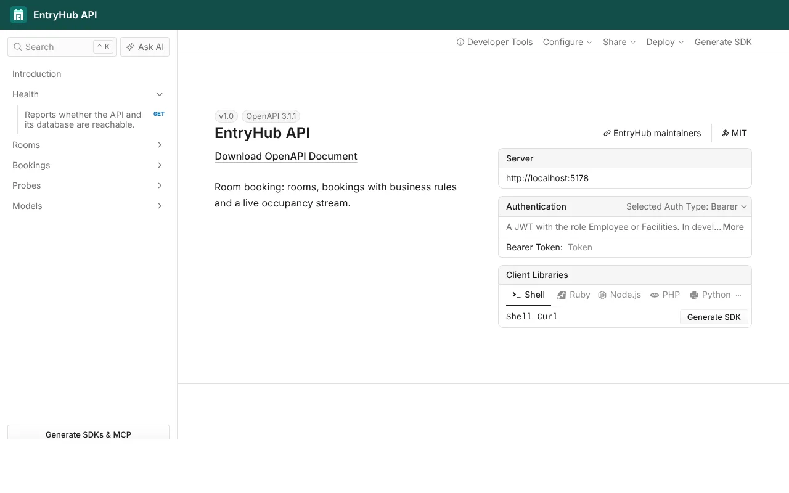

La página de Scalar de [entry-hub](https://github.com/MookieFumi/entry-hub) funcionaba, pero era idéntica a la de cualquier otra API: el mismo tema, ningún logo y ni una pista de a quién escribir si algo falla. En una API interna da un poco igual, pero si la van a integrar otros equipos, la documentación es lo primero que ven.

En esta píldora le damos a entry-hub su propia cara sin tocar ningún endpoint. Son unas pocas líneas en el documento OpenAPI y en Scalar, y algo de CSS. De paso, entry-hub estrena logo: un calendario con una puerta, que es lo que hace la aplicación, reservar salas.

## Contacto y licencia en el documento

Lo primero no es estético. El documento OpenAPI tiene un sitio para decir quién mantiene la API y con qué licencia se usa, dentro de `info`. En entry-hub lo rellena el transformer de documento que ya pone el título, como vimos en el [post de OpenAPI](/2026-09-25-openapi-scalar-minimal-apis):

```csharp
document.Info = new OpenApiInfo
{
    Title = "EntryHub API",
    Version = "1.0",
    Description = "Room booking: rooms, bookings with business rules and a live occupancy stream.",
    Contact = new OpenApiContact
    {
        Name = "EntryHub maintainers",
        Url = new Uri($"{RepositoryUrl}/issues"),
    },
    License = new OpenApiLicense
    {
        Name = "MIT",
        Url = new Uri($"{RepositoryUrl}/blob/main/LICENSE"),
    },
};
```

Como contacto ponemos la URL de las issues del repositorio y no un correo personal, porque el documento se publica con cada release. `OpenApiContact` también admite un `Email` si tienes un buzón de equipo.

Esta parte va en el contrato, así que la recibe cualquiera que lo use, también quien genere un cliente a partir de él:

```json
"contact": {
  "name": "EntryHub maintainers",
  "url": "https://github.com/MookieFumi/entry-hub/issues"
},
"license": {
  "name": "MIT",
  "url": "https://github.com/MookieFumi/entry-hub/blob/main/LICENSE"
}
```

Scalar enseña los dos datos como enlaces arriba a la derecha, junto al título.

## El logo

Con el logo me llevé una sorpresa. Hay una extensión muy extendida para poner un logo en el documento, `x-logo`, pero es de Redoc. He buscado en los ficheros de Scalar que trae el paquete y no la usan, así que el logo va en la página.

`AddHeaderContent` añade HTML justo encima de la referencia. Con eso montamos una barra con el logo y el nombre de la API:

```csharp
public const string Header =
    """<header class="entryhub-brand">""" + Logo + """<span>EntryHub API</span></header>""";
```

`Logo` es el SVG del logo como texto, el mismo que está en `docs/logo.svg`. Al ir dentro del HTML, la API no tiene que servir ningún fichero estático.

El favicon sale del mismo SVG. `WithFavicon` acepta una ruta o una URL, y una URL `data:` también vale:

```csharp
public static readonly string Favicon = "data:image/svg+xml," + Uri.EscapeDataString(Logo);
```

## Colores y tema

Scalar trae varios temas (`ScalarTheme.Saturn`, `ScalarTheme.Mars`, `ScalarTheme.Purple`...). Si quieres tus colores, lo más limpio es partir de `ScalarTheme.None` y definir solo lo que cambia. Scalar lee sus colores de variables CSS, con un juego para el modo claro y otro para el oscuro:

```css
.light-mode {
  --scalar-color-accent: #0f766e;
  --scalar-background-accent: #0f766e1f;
}
.dark-mode {
  --scalar-color-accent: #2dd4bf;
  --scalar-background-accent: #2dd4bf1f;
}
```

El verde del modo oscuro es más claro, porque el mismo tono que se lee bien sobre blanco se pierde sobre fondo oscuro. La misma hoja lleva el estilo de la barra del logo.

Todo junto queda así en `MapEntryHubDocumentation`, con el logo, el CSS y el favicon en una clase `ScalarBranding`:

```csharp
app.MapScalarApiReference(options => options
    .WithTitle("EntryHub API")
    .AddPreferredSecuritySchemes(BearerScheme)
    .WithFavicon(ScalarBranding.Favicon)
    .AddHeaderContent(ScalarBranding.Header)
    .WithTheme(ScalarTheme.None)
    .WithCustomCss(ScalarBranding.Css));
```

Y este es el resultado en local:



Si la empresa tiene su propia tipografía, `DisableDefaultFonts` evita que Scalar cargue las suyas y puedes ponerla en el mismo CSS con `--scalar-font`.

## Que la página pública se vea igual

En el post de OpenAPI vimos que cada release publica una documentación estática en GitHub Pages, con Scalar cargado desde un CDN. Esa página no pasa por `MapScalarApiReference`, así que no recibe nada de lo anterior. Si no hacemos nada, la documentación local y la pública son dos páginas distintas.

`docs/index.html` repite la misma cabecera y el mismo CSS, y le pasa el tema a Scalar en la configuración:

```html
<header class="entryhub-brand"><span>EntryHub API</span></header>
<div id="app"></div>
<script src="https://cdn.jsdelivr.net/npm/@scalar/api-reference@1.72.3"></script>
<script>
  Scalar.createApiReference("#app", { url: "./openapi.json", theme: "none" });
</script>
```

El workflow de release copia `docs/logo.svg` junto a la página, igual que ya hacía con el contrato. El CSS está repetido en dos sitios, y lo he dejado así a propósito: son veinte líneas, y compartirlas obligaría a la API a servir ficheros estáticos solo para esto. Un comentario en cada sitio avisa de que hay que cambiar los dos.

## Resumiendo

- El contacto y la licencia van en `OpenApiInfo` y viajan en el contrato. El logo, el favicon y los colores van en Scalar, porque Scalar no lee `x-logo`.
- `ScalarTheme.None` más unas variables CSS para el modo claro y el oscuro bastan para tener los colores de la empresa, y la página estática de la release repite lo mismo.

El código está en [entry-hub](https://github.com/MookieFumi/entry-hub). En la siguiente píldora vemos por qué entry-hub versiona la API con grupos de rutas y no con `Asp.Versioning.Http`.
